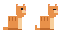
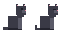
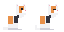
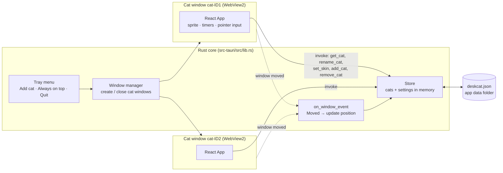
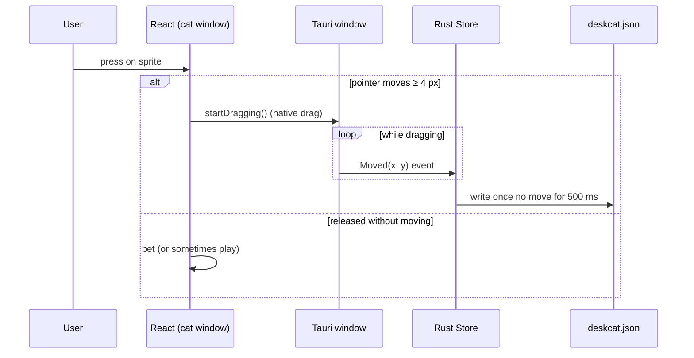

<div align="center">

# 🐱 DeskCat

**A tiny pixel-art cat that lives on your Windows desktop.**

[](https://github.com/sarauh-codes/deskcat/actions/workflows/build.yml)







</div>

> **Project status — please read.** The MVP described below is **written and builds successfully in CI**. It has been **smoke-tested on Windows 11**: the CI-built `deskcat.exe` launches, stays running, and shows the cat with its tray icon. Full behaviour (drag, petting, tray menu, installer, long-running use) is **not yet verified**. Everything marked *Implemented* means "the code exists in this repository", not "tested and confirmed working". See [Known Limitations](#known-limitations).

## Table of Contents

- [Introduction](#introduction)
- [Project Overview](#project-overview)
- [Key Features](#key-features)
- [Technology Stack](#technology-stack)
- [How DeskCat Works](#how-deskcat-works)
- [Cat System](#cat-system)
- [User Interface and User Experience](#user-interface-and-user-experience)
- [Project Structure](#project-structure)
- [Installation and Setup](#installation-and-setup)
- [Usage Guide](#usage-guide)
- [Data Storage and Privacy](#data-storage-and-privacy)
- [Differences from the Original Overview](#differences-from-the-original-overview)
- [Development Roadmap](#development-roadmap)
- [Known Limitations](#known-limitations)
- [Future Improvements](#future-improvements)
- [Contributing](#contributing)
- [License](#license)
- [Acknowledgements](#acknowledgements)

## Introduction

**DeskCat** puts one or more animated pixel-art cats on your Windows desktop. Drag them around, pet them, give them names, change their fur, and find them where you left them the next time you start the app.

### Why it exists

DeskCat is a small, charming companion for the hours you spend working, studying, browsing, or gaming. It is deliberately **not** a full pet simulator or a productivity tool: no hunger bars, no shops, no progression. The goal is a handful of polished interactions and nice-looking animations, built as a 1–3 day MVP (see [`PROJECT_OVERVIEW.md`](PROJECT_OVERVIEW.md) for the original vision).

### What makes it different from a normal desktop app

- There is **no main window**. Each cat is a small, borderless, transparent window that floats on the desktop.
- It is **local-first**: no account, no backend, no internet connection needed for any feature.
- Its only "control panel" is a **system tray icon** and a right-click menu on each cat.

### Who it is for

- People who like cute desktop companions while they work, study, browse, or play.
- Developers interested in a small, readable example of a Tauri 2 + React + TypeScript desktop app with transparent windows.

## Project Overview

DeskCat is a desktop pet. Each cat is its own transparent native window showing a pixel-art sprite. The cat idles, sits, sleeps, occasionally walks along the bottom of its monitor, and reacts when clicked.

- **Interacting:** click a cat to pet it (sometimes it plays instead); press-and-drag to move it; cats that get close greet each other; right-click for a menu (pet, play, rename, change appearance, add another cat, remove).
- **Multiple cats:** every cat has its own ID, name, skin, and position, and its own window. Add as many as you like from the cat menu or the tray.
- **Alongside other applications:** cats float over other windows by default (**Always on top** can be toggled from the tray). They have no taskbar button. Clicks on the cat's own window go to the cat; the rest of the screen is unaffected because each window is only 160×160 logical pixels.
- **Intended experience:** a quiet companion that is there when you glance at the desktop, never in the way, and costs little to run.

## Key Features

**Legend**

| Label | Meaning |
|---|---|
| ✅ **Implemented** | Code for it exists in this repo and compiles in CI. *Not every feature has been verified on a desktop.* |
| 🗓️ **Planned** | Part of the original MVP scope, but not implemented. |
| 💡 **Future** | Mentioned as a possible later idea only. |

### Desktop pet functionality

| Feature | Status |
|---|---|
| Transparent, frameless, borderless cat windows (no shadow, not resizable) | ✅ Implemented |
| One native window per cat, no taskbar button | ✅ Implemented |
| System tray icon with **Add cat**, **Always on top**, **Quit** | ✅ Implemented |
| Always-on-top toggle (on by default, see [differences](#differences-from-the-original-overview)) | ✅ Implemented |
| Only one running instance (a second launch is ignored) | ✅ Implemented |
| Windows installer (NSIS) built in CI | ✅ Implemented |

### Cat interactions

| Feature | Status |
|---|---|
| Click a cat to pet it (about 30% of clicks start playing instead) | ✅ Implemented |
| Press-and-drag a cat to move it | ✅ Implemented |
| Right-click context menu: Pet, Play, Rename, Change appearance, Add another cat, Remove cat | ✅ Implemented |
| Optional meow / interaction sound with a mute setting | 🗓️ Planned (optional in the overview, not implemented) |
| Cats following or chasing the cursor | 💡 Future |
| Cats close to each other greet with a speech bubble | ✅ Implemented (added after the MVP; the overview had it out of scope) |

### Cat customisation

| Feature | Status |
|---|---|
| Seven predefined skins: orange, black, white, calico, gray, cream, tortoiseshell | ✅ Implemented |
| Rename a cat (inline text box, up to 20 characters) | ✅ Implemented |
| Fully layered character editor / arbitrary colours | 💡 Future (out of MVP scope) |
| Accessories (hats, bows, collars) | 💡 Future |
| User-imported sprites | 💡 Future |

### Multiple cat management

| Feature | Status |
|---|---|
| Add and remove cats | ✅ Implemented |
| Unique ID, name, skin and position per cat | ✅ Implemented |
| Off-screen saved positions reset to the primary monitor on start | ✅ Implemented |
| Reliable multi-monitor behaviour | 🗓️ Planned (overview: "test if time permits") |

### Animations and behaviour

| Feature | Status |
|---|---|
| Idle, Sitting, Sleeping, Walking, Petting, Playing animations (sprite sheets) | ✅ Implemented |
| Random mood changes every 5–12 seconds | ✅ Implemented |
| Animation timers skip frames while the page is hidden | ✅ Implemented |
| Stretching animation | 🗓️ Planned (marked *optional* in the overview) |
| Distinct cat personalities | 💡 Future |

### Settings and preferences

| Feature | Status |
|---|---|
| Always-on-top preference (saved) | ✅ Implemented (via the tray menu) |
| Sound on/off preference | 🗓️ Planned (no sound exists yet) |
| Dedicated settings panel / window | 🗓️ Not implemented — the tray menu is the only settings UI |
| Launch on startup | 💡 Future (explicitly out of MVP scope) |

### Local data persistence

| Feature | Status |
|---|---|
| Cats (ID, name, skin, X/Y) and the always-on-top preference are saved locally | ✅ Implemented |
| Cats and positions restored on launch; one default cat on first run | ✅ Implemented |

## Technology Stack

| Technology | What it is | Where DeskCat uses it | Why it fits |
|---|---|---|---|
| **Tauri 2** | A framework for desktop apps with a web UI and a Rust core. | Creates and manages the native windows, the tray icon, and packaging. | Small installers and low memory use compared with bundling a full browser; first-class transparent and frameless windows. Chosen in the original overview. |
| **Rust** | A systems language. | `src-tauri/src/lib.rs`: window creation, tray menu, save file, window-move tracking. | The overview says to use Rust only where native integration is required; here it also owns state so there is a single writer of the save file. |
| **React 19** | A UI library. | `src/App.tsx`: renders a cat, handles pointer input, runs animation and behaviour timers. | Simple state-driven UI; the same bundle is reused by every cat window. |
| **TypeScript** | JavaScript with static types. | All frontend code (`src/`). | Type-checked cat and animation definitions (`src/data/cats.ts`). |
| **CSS** | Styling. | `src/App.css`: transparent page, name label, pixelated sprite rendering. | `image-rendering: pixelated` keeps pixel art crisp; no UI library needed. |
| **Vite** | Frontend build tool and dev server. | `npm run dev` / `npm run build`. | Default for Tauri + React templates. |
| **JSON file via Rust** | Local persistence. | `deskcat.json` in the app data folder, read and written by Rust with `serde_json`. | See [Differences](#differences-from-the-original-overview): the overview allowed "the official Tauri Store plugin, or another simple Tauri-supported local persistence approach". |
| **`tauri-plugin-single-instance`** | Official Tauri plugin. | Prevents duplicate cats if the app is launched twice. | A few lines of code for a real annoyance. |
| **GitHub Actions** | CI. | `.github/workflows/build.yml` builds the Windows installer. | Allows building without a local Rust toolchain. |

Not used: SQLite or any database, any backend or hosted service, any accounts or login (all explicitly excluded by the overview).

## How DeskCat Works

### Architecture



### Desktop window architecture

DeskCat uses **one small native window per cat** (the overview's "Approach A"). Each is 160×160 logical pixels: a 32 px name row on top and a 128 px sprite (a 32×32 pixel sprite at 4× scale, which stays an integer number of device pixels at 100/125/150/175/200% display scaling).

The windows are created from Rust with `decorations(false)`, `transparent(true)`, `shadow(false)`, `resizable(false)`, and `skip_taskbar(true)`. Window labels are `cat-<id>`, and the React app reads its own label to know which cat it shows. All windows load the same frontend bundle.

The overview recommended prototyping a single full-screen window (Approach B) first. That was **not** tried; see [Differences](#differences-from-the-original-overview) for why Approach A was chosen.

### Rendering and animation

Each skin has one PNG sprite sheet per animation, a horizontal strip of 32×32 frames, in `public/assets/cats/<skin>/<animation>.png`. A `useFrame` hook in `src/App.tsx` advances a frame index with `setInterval`, and the sheet is shown as a CSS `background-image` with `background-position` moved one frame at a time. One-shot animations (petting) return the cat to idle when they finish.

| Animation | Frames | Frame time | Loops |
|---|---|---|---|
| idle | 4 | 450 ms | yes |
| sitting | 2 | 700 ms | yes |
| sleeping | 2 | 700 ms | yes |
| walking | 4 | 140 ms | yes |
| petting | 4 | 300 ms | no |
| playing | 4 | 180 ms | yes (stops after 3 s) |

### Behaviour

Every 5–12 seconds each cat picks a new mood (idle, sitting, sleeping, walking or playing, with idle/sitting/walking weighted a little higher). It does not change mood while it is being petted, walking or playing. When two cat windows come close, both show a short greeting bubble and face each other (sleeping cats stay quiet; each cat greets at most once every 20 seconds). **Walking** slides the native window horizontally for about 2.5 seconds, bouncing off the edges of the current monitor.

### Dragging and positioning



A plain click and a drag share the same press, so DeskCat waits for the pointer to move 4 px before starting a native drag; otherwise the release counts as a pet. Windows swallows the mouse-up after a native drag, so the **final position is taken from the window's `Moved` events** (in Rust), not from a mouse-up handler. Positions are stored in **physical pixels**.

### Multiple cats

The Rust `Store` holds the list of cats. Adding a cat creates a new window with the next name and skin from fixed lists (names: Mochi, Miso, Tofu, Boba, Kiki, Nori; skins: orange, black, white, calico, gray, cream, tortoiseshell, cycling) and places it near the bottom-right of the primary monitor. Removing a cat deletes it from the list and closes its window. The app keeps running with zero cats (the tray remains).

### How settings reach the cat windows

There is no separate settings window and no "main" window. The tray menu lives in Rust. Toggling **Always on top** updates the stored setting and applies it directly to every open cat window.

### Saving and restoring

All state lives in Rust. The cat windows ask Rust for their data (`get_cat`) and send changes back (`rename_cat`, `set_skin`, `add_cat`, `remove_cat`), so there is a single writer of the save file and no race between windows. On startup Rust reads the file, moves any cat whose centre is no longer on a connected monitor back onto the primary monitor, and opens a window per cat. On first run (no readable save file) it creates one default cat.

## Cat System

### Data model

The Rust struct that is saved to disk:

```rust
struct Cat {
    id: String,   // timestamp-based, e.g. "1732432800000"
    name: String, // trimmed, max 20 characters
    skin: String, // one of the names in SKINS
    x: i32,       // physical pixels
    y: i32,
}
```

What the frontend receives and the animation definitions (`src/data/cats.ts`):

```ts
export const SKINS = ["orange", "black", "white", "calico", "gray", "cream", "tortoiseshell"] as const;

export type Anim = "idle" | "sitting" | "sleeping" | "walking" | "petting" | "playing";

export interface Cat {
  id: string;
  name: string;
  skin: string;
}
```

Example save file:

```json
{
  "cats": [
    { "id": "1732432800000", "name": "Mochi", "skin": "orange", "x": 2200, "y": 760 }
  ],
  "always_on_top": true
}
```

The current animation is **not** saved: every cat starts in idle after a restart, as the overview allows.

### Appearances

| Skin | Look |
|---|---|
| `orange` | Orange tabby with stripes |
| `black` | Dark grey / black |
| `white` | White |
| `calico` | White with orange and dark patches |
| `gray` | Gray tabby |
| `cream` | Pale cream tabby |
| `tortoiseshell` | Dark brown with orange mottling, yellow eyes |

All skins share identical frame sizes, frame counts and timings, so a single animation system serves all of them.

### Interaction behaviour

- **Click** (without dragging): usually petting, sometimes playing with a yarn ball, then back to idle. Petting a sleeping cat wakes it.
- **Drag**: starts the native window drag after 4 px of movement.
- **Right-click**: native context menu (see [UI](#user-interface-and-user-experience)).

### Adding a new skin

The sprites are generated by `scripts/gen-sprites.mjs`, not hand-drawn. To add a skin:

1. Add a palette entry to `SKINS` in `scripts/gen-sprites.mjs` (body, shade, light colours; optional `stripe` flag or `patches`).
2. Add the same name to `SKINS` in `src/data/cats.ts` and to the `SKINS` constant in `src-tauri/src/lib.rs` (Rust validates skin names).
3. Run `node scripts/gen-sprites.mjs` to write `public/assets/cats/<name>/*.png`.

Hand-drawn art can be used instead: provide the six sheets with the same frame size (32×32) and frame counts as the table above.

## User Interface and User Experience

- **Visual style:** pixel art, rendered with `image-rendering: pixelated` at 4× scale.
- **Floating pet:** a borderless, transparent window; only the cat and its name label are visible.
- **Drag and drop:** native window dragging.
- **Context menus:** a **native Windows menu** opened with right-click. It is functional but **not** pixel-art styled (a small deviation from the overview's wish for menus consistent with the pixel style).
- **Rename:** an inline text box replaces the name label; Enter confirms, Escape cancels.
- **Settings interface:** the system tray menu only. There is no settings panel.
- **Other open windows:** cats float above other windows when *Always on top* is on (the default). They are not shown over exclusive-fullscreen games.

No screenshots are included yet.

## Project Structure

This is the **actual** structure (it differs slightly from the structure proposed in `PROJECT_OVERVIEW.md`; see the [differences table](#differences-from-the-original-overview)).

```text
deskcat/
├── .github/workflows/build.yml   # CI: builds the Windows installer, uploads it as an artifact
├── public/assets/cats/<skin>/    # generated sprite sheets: idle, sitting, sleeping, walking, petting, playing
├── scripts/
│   ├── gen-sprites.mjs           # generates all sprite sheets and icon.png
│   └── icon.png                  # source image for the app icons
├── src/
│   ├── App.tsx                   # one cat: sprite, animation hook, behaviour, pointer + menu handling
│   ├── App.css                   # transparent page, name label, pixelated sprite
│   ├── main.tsx                  # React entry point
│   └── data/cats.ts              # skins, animation config, Cat type
├── src-tauri/
│   ├── src/lib.rs                # all Rust: state, save file, windows, tray, commands
│   ├── src/main.rs               # entry point
│   ├── capabilities/default.json # permissions for windows labelled cat-*
│   ├── icons/                    # generated app icons
│   ├── Cargo.toml
│   └── tauri.conf.json           # app config (no windows declared; they are created at runtime)
├── PROJECT_OVERVIEW.md           # original vision and requirements
├── index.html
├── package.json
└── vite.config.ts
```

## Installation and Setup

### Prerequisites

- **Windows 10/11** (the only target platform). WebView2 is included with Windows 11; on older Windows 10 the installer's bootstrapper can fetch it.
- **Node.js 22 or newer** (CI uses 22).
- **Rust** (stable; the project uses Rust edition 2024, which needs Rust 1.85+), installed via [rustup](https://rustup.rs).
- **Microsoft C++ Build Tools**: Visual Studio Build Tools with the *Desktop development with C++* workload.
- **Git**.

### Run in development

```powershell
git clone https://github.com/sarauh-codes/deskcat.git
cd deskcat
npm install
npm run tauri dev
```

The first Rust compile takes several minutes; later runs are much faster. There is no `.env` file or other environment setup.

### Other scripts

| Command | What it does |
|---|---|
| `npm run dev` | Frontend dev server only (cats need the Tauri shell, so use `tauri dev` instead) |
| `npm run build` | Type-check (`tsc`) and build the frontend into `dist/` |
| `npm run tauri dev` | Run the full desktop app with hot reload |
| `npm run tauri build` | Build the release app and installer |
| `node scripts/gen-sprites.mjs` | Regenerate sprite sheets (`--preview` also writes preview images) |

### Build the Windows installer

```powershell
npm run tauri build
```

Output:

- Installer: `src-tauri/target/release/bundle/nsis/DeskCat_0.1.0_x64-setup.exe`
- Portable executable: `src-tauri/target/release/deskcat.exe`

Only the `nsis` bundle target is enabled. The installer and executable are **unsigned**, so Windows SmartScreen may warn on first run (**More info → Run anyway**).

### Build without a local toolchain

The `build` workflow runs on every push. Open the latest successful run under **Actions** and download the `deskcat-windows` artifact (a GitHub sign-in is required to download artifacts).

## Usage Guide

> Steps below describe the intended behaviour of the current code. The app launches on Windows 11, but these steps have **not** each been verified yet.

| Task | How |
|---|---|
| **Launch** | Run `deskcat.exe` or the installed app. A cat appears near the bottom-right of the primary monitor, with a tray icon. On the very first run you get one orange cat named Mochi. |
| **Add a cat** | Tray icon → **Add cat**, or right-click a cat → **Add another cat**. |
| **Drag a cat** | Press on the cat, move the pointer a few pixels, and keep dragging. Its position is saved shortly after you stop. |
| **Pet a cat** | Click it without moving the pointer. |
| **Change appearance** | Right-click → **Change appearance** → pick a skin (the current one has a • marker). |
| **Rename** | Right-click → **Rename**, type a name (max 20 characters), press Enter. Escape cancels. |
| **Remove a cat** | Right-click → **Remove cat**. |
| **Manage multiple cats** | Each cat has its own window and right-click menu; the tray adds more. |
| **Always on top** | Tray icon → **Always on top** (checked by default). |
| **Quit** | Tray icon → **Quit DeskCat**. There is no taskbar button and no close button, so the tray is the only way to exit. |
| **Open settings** | 🗓️ Not implemented. There is no settings window. |
| **Mute sounds** | 🗓️ Not implemented. There are no sounds yet. |

## Data Storage and Privacy

- **Where:** a single file, `deskcat.json`, in the Tauri app data directory for the identifier `com.deskcat.app`. On Windows this is expected to be `%APPDATA%\com.deskcat.app\deskcat.json` (the path has not yet been confirmed on disk).
- **What is stored:** for each cat its ID, name, skin and X/Y position (physical screen pixels), plus the *Always on top* preference. Nothing else is written by DeskCat.
- **When it is written:** immediately on rename, skin change, add, remove and setting changes; for dragging, once the cat has stopped moving for 500 ms, and again on Quit.
- **Internet:** the DeskCat code contains no network calls and needs no connection to run. (Installing dependencies and building from source do need the internet.)
- **Accounts / cloud:** none. There is no backend, login, or cloud sync.
- **Scope of this statement:** it describes the code in this repository. Third-party dependencies (Tauri, WebView2, etc.) have not been audited for this README.

## Differences from the Original Overview

The original [`PROJECT_OVERVIEW.md`](PROJECT_OVERVIEW.md) is still the statement of intent (its "Planning / not yet implemented" status line is now out of date). Where the implementation differs:

| Topic | Overview | Current implementation | Why |
|---|---|---|---|
| Window architecture | Prototype a single full-screen window (B) first; evaluate one window per cat (A) only if B fails | One window per cat (A); **B was never prototyped** | A full-screen transparent window blocks clicks to apps beneath unless cursor hit-testing is added; per-cat windows give native dragging and simple multi-monitor behaviour. A decision made during technical review, not based on a failed B prototype. |
| Persistence | Tauri Store plugin "or another simple approach" | JSON file written by Rust | One writer, no extra plugin, no race between windows. |
| Always on top | Optional setting; overview says it need not be pinned (`alwaysOnTop: false` in the example) | **Defaults to on**, toggle in tray | A pet hidden behind other windows is mostly invisible. This changes the overview's default. |
| Settings UI | `SettingsPanel` and sound preference | Tray menu only; no sound | Smaller MVP. |
| Context menu | Compact, pixel-styled | Native Windows menu | Fits no other way in a 160×160 window; far less code. |
| Saved data | Model includes `currentAnimation` | Not saved (always restarts idle) | The overview notes this is acceptable. |
| Components / hooks | `CatPet`, `CatAnimation`, `CatContextMenu`, `CatSelector`, `SettingsPanel`, three hooks | `App.tsx` plus `data/cats.ts` | Fewer files for a small app. |
| Animations | Includes optional Stretching and Playing | Playing implemented; Stretching not | Marked optional. |
| Sprites | Not specified | Generated by script, not hand-drawn | No art assets existed. |

## Development Roadmap

Checked means "present in the code". A check does **not** mean verified on a desktop; the unchecked verification items cover that.

### MVP

- [x] Tauri 2 + React + TypeScript project
- [x] Transparent, frameless cat windows
- [x] Four cat appearances (now seven)
- [x] More than one cat on screen
- [x] Drag cats to new positions
- [x] Idle, sitting, sleeping, walking and petting animations
- [x] Rename cats
- [x] Change a cat's appearance
- [x] Pet a cat by clicking
- [x] Add and remove cats
- [x] Cats and positions persist after restart
- [x] Windows installer builds in CI
- [x] Windows build launches (smoke test on Windows 11: runs, shows cat and tray icon)
- [ ] Verify everything on a real Windows desktop: drag, petting, tray menu, installer (**next step**)
- [ ] Windows build "behaves reliably" over normal use (unverified)
- [ ] Optional sound effects and mute setting
- [ ] Multi-monitor testing

### Short-term improvements

- [ ] Fix whatever fuller desktop testing finds (drag feel, shadows, sprite sharpness at different display scales)
- [ ] Add screenshots or a short demo GIF to this README
- [x] Playing animation
- [x] Cats greet each other
- [ ] Stretching animation
- [ ] Pixel-styled menus
- [ ] Automated tests
- [ ] Code signing for the installer

### Long-term possibilities

- [ ] Cat personalities and varied idle behaviour
- [ ] Cats following the cursor
- [ ] Accessories
- [ ] User-imported sprites
- [ ] More breeds and colours
- [ ] Optional launch-on-startup
- [ ] Better multi-monitor support

## Known Limitations

- **Only smoke-tested.** Launch, the cat and the tray icon were confirmed on Windows 11; drag, petting, menus, the installer and long-running use are not yet verified.
- **Transparent corners still catch clicks.** Each 160×160 window is rectangular, so clicking the transparent area around the sprite does not reach the app underneath.
- **Not shown over exclusive-fullscreen games**, even with *Always on top*.
- **Unsigned installer**: SmartScreen warns on first run.
- **Native context menu** is not pixel-art styled.
- **No sound, no settings panel, no Stretching animation.**
- **Walking is horizontal only** and is limited to the monitor the cat is on.
- **Multi-monitor and mixed-DPI setups are untested.** Position restore only checks that the cat's centre is on some connected monitor.
- **A crash within about half a second of a drag** can lose that last move (positions are written after movement settles).
- **Menu objects are not explicitly freed:** each right-click creates a native menu object that is not closed afterwards. Likely harmless for normal use, not measured.
- **Windows only.** Other platforms are not targeted or tested.
- **No automated tests** yet.

## Future Improvements

Ideas only; none are current features and none are scheduled: following the cursor, personalities, richer cat-to-cat interactions, accessories, importing your own sprites, more breeds, launch on startup, richer multi-monitor handling, a pixel-styled context menu, and a signed installer.

## Contributing

Contributions are welcome, keeping the project's goal of **small and lightweight** in mind (see the out-of-scope list in [`PROJECT_OVERVIEW.md`](PROJECT_OVERVIEW.md)).

1. Open an issue to discuss larger changes first.
2. Fork the repository and create a branch.
3. Set up the project as described in [Installation and Setup](#installation-and-setup).
4. Before opening a pull request, make sure `npm run build` (type-check) passes and that `npm run tauri dev` starts. There are no automated tests yet, so please describe how you checked your change.
5. Open a pull request describing what changed and why.

## License

DeskCat is released under the [MIT License](LICENSE).

## Acknowledgements

- [Tauri](https://tauri.app), [React](https://react.dev), [Vite](https://vite.dev) and [TypeScript](https://www.typescriptlang.org), the open-source tools DeskCat is built on.
- Microsoft Edge WebView2, which renders the UI on Windows.
- The cat sprites are generated by `scripts/gen-sprites.mjs` in this repository. No third-party art, sound or artists are credited because none are used.
